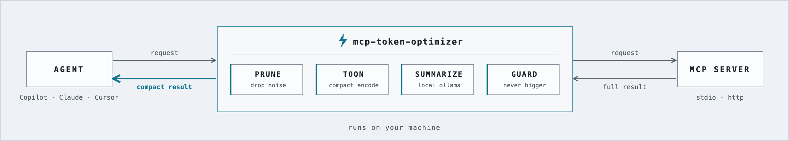

<div align="center">

# ⚡ mcp-token-optimizer

### Stop paying for tool-response noise.

**A self-hosted proxy between your AI agent and its MCP servers that shrinks every tool response: pruning, [TOON](https://github.com/toon-format/toon) encoding and local-LLM summarization, without changing what the agent can do.**

[](https://github.com/shubhamcodess/mcp-token-optimizer/actions/workflows/ci.yml)
[](LICENSE)
[](https://nodejs.org)
[](https://ollama.com)
[](https://modelcontextprotocol.io)
[](CONTRIBUTING.md)
[](https://github.com/shubhamcodess/mcp-token-optimizer)

[**Quick start**](#quick-start) &nbsp;·&nbsp; [**How it works**](docs/how-it-works.md) &nbsp;·&nbsp; [**Docs**](#documentation) &nbsp;·&nbsp; [**Testing**](TESTING.md) &nbsp;·&nbsp; [**Contributing**](CONTRIBUTING.md)

</div>

---

<p align="center">
  <picture>
    <source media="(prefers-color-scheme: dark)" srcset="docs/architecture-dark.png">
    
  </picture>
</p>

## Why

Every token an MCP tool returns is paid for, and fills the model's context window. Real tool output is mostly noise: `null` fields, hypermedia URLs, avatar and node ids, the same block repeated in two fields, ANSI and progress-bar spam, boilerplate prose. `mto` removes that noise **before the model sees it**, keeps an exact copy of anything it removed, and tells the agent how to get it back.

> **Local only, always.** `mto` talks only to your own MCP servers and to a local Ollama on `127.0.0.1`. No telemetry, no cloud model providers, nothing leaves your machine. The dashboard and its API bind to loopback, need a per-run token, and cannot run arbitrary commands. See [Security and privacy](SECURITY.md#16-security-and-privacy).

## Results

Measured, reproducible, no LLM involved (`npm run smoke`, [TESTING.md](TESTING.md)). Token counts are a model-agnostic estimate.

| Tool response | Original | Sent to the agent | Saved |
|---|---:|---:|---:|
| GitHub issue list (40 issues, REST JSON) | 37,355 | 13,244 | **64.5%** |
| Kubernetes describe + manifest (duplicated content) | 3,637 | 1,935 | **46.8%** |
| CI build log (ANSI, repeated lines) | 4,926 | 78 | **98.4%** |
| HTML runbook page | 1,198 | 863 | **28.0%** |
| *Real* Kubernetes ConfigMap through a live MCP server, Copilot A/B run | 24,616 | 12,617 | **48.7%** |

In that live A/B run, the three files the agent wrote from the optimized result were **byte-identical** to the original data (checked against a pre-optimization capture).

## Highlights

| | |
|---|---|
| 🧾 **Lossless first** | JSON ↔ TOON is emitted only after a verified round-trip; duplicate blocks become pointers; the canonical copy is never touched |
| 🛟 **Fail-open, never bigger** | any error, timeout or Ollama outage forwards the original; an optimized result is used only if it is strictly cheaper |
| 🔎 **`mto_expand`** | notes name exactly what was pruned; the agent can fetch the exact original (outline, JSON path, grep) on demand |
| 🌗 **Shadow mode** | measure real savings while forwarding the originals, so you can roll out with zero risk |
| 🔌 **Any MCP client** | stdio wrapper *and* local HTTP/SSE proxy; installs into VS Code Copilot, Claude, Cursor, Windsurf, Gemini CLI, Cline, Roo (JSONC-safe, reversible) |
| 🧠 **Local summarization** | your Ollama model, your parameters, a hard latency budget and a fact-coverage guard; code and file reads are never summarized |
| 🔐 **Private by design** | binds to `127.0.0.1`, no telemetry, credentials forwarded but never stored, optional secret redaction |
| 🖥️ **Local dashboard** | `mto ui`: overview, live traffic, connections, config editor, eval history, advisor and drift warnings, served by the daemon, no CDN ([dashboard guide](docs/dashboard.md)) |
| 🧪 **Measurable** | capture, bench, compare and stats built in; 89 tests and a 24-check end-to-end smoke test |

## Quick start

```bash
npm install -g @shubhamcodess/mcp-token-optimizer    # or clone and build; see the install guide
mto doctor                                           # checks config, Ollama and model
mto discover                                         # lists the MCP servers it found (read-only)
mto init --only <server> --apply                     # wrap one server; undo: mto uninstall --apply
```

No agent handy? `npm run demo` shows a tool call through the optimizer with sample data.

> **Roll out safely:** set `mode: shadow` first. The proxy then measures savings but forwards the original responses, so nothing changes for your agent until you switch to `active`.

Full walkthrough: [Getting started](docs/getting-started.md).

## Documentation

| Guide | What is in it |
|---|---|
| 🚀 [**Getting started**](docs/getting-started.md) | Install, wire your agent, try it without an agent |
| 🧠 [**How it works**](docs/how-it-works.md) | The pipeline, operating modes, stdio vs HTTP, `mto_expand` |
| 🎛️ [**Tuning**](docs/tuning.md) | Profiles, output formats, local summarization, capture and bench |
| 📖 [**Reference**](docs/reference.md) | Every config key, CLI command, file and environment variable |
| 🖥️ [**Dashboard**](docs/dashboard.md) | What each page shows and what it can change |
| 🛟 [**Troubleshooting**](TROUBLESHOOTING.md) | Symptoms, causes and fixes |
| 🔐 [**Security and privacy**](SECURITY.md) | Threat model, what is stored, redaction, reporting a vulnerability |
| 🧪 [**Testing**](TESTING.md) | Automated tests, benchmarks, live A/B procedure, verification status |
| 🤝 [**Contributing**](CONTRIBUTING.md) | Dev setup, code layout, checks, pull request checklist |
| 📜 [**Code of conduct**](CODE_OF_CONDUCT.md) | Expected behaviour in this project |
| 📝 [**Changelog**](CHANGELOG.md) | Release history |

## Contributing

Contributions of all sizes are welcome: bug reports, docs, benchmark results, new agent integrations, pipeline improvements. Start with **[CONTRIBUTING.md](CONTRIBUTING.md)** and please read the [Code of Conduct](CODE_OF_CONDUCT.md). Security issues: [SECURITY.md](SECURITY.md).

## License

[Apache-2.0](LICENSE). Uses the official [`@toon-format/toon`](https://github.com/toon-format/toon) library for TOON, and [Ollama](https://ollama.com) for optional local summarization.
