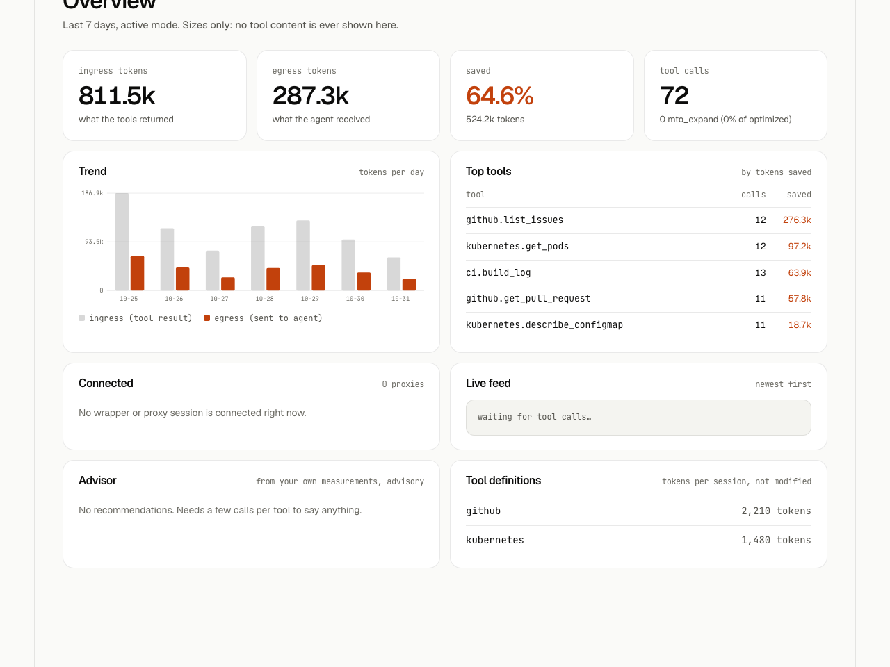
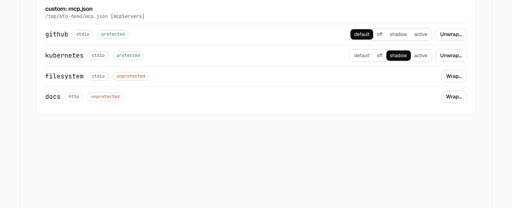

# The dashboard

The local web UI served by the daemon: what each page shows and what it can change.

## 19. The dashboard

> A local web UI served by the daemon: watch what mto does, change settings safely, and measure before you roll out.

```bash
mto ui          # starts the daemon if needed and opens http://127.0.0.1:8787/
```

`mto ui` opens the page with the per-run token in the URL *fragment* (never sent to the server, removed from the address bar on load). Opening the plain URL only shows "run `mto ui`". Stdio wrappers start the daemon automatically (`ui.autoStart`); it never opens a browser by itself. Keep it running in the background with `mto service install --apply` (macOS launchd, Linux systemd user unit).

<p align="center">
  <picture>
    <source media="(prefers-color-scheme: dark)" srcset="screenshots/ui-overview-dark.png">
    
  </picture>
</p>

| Page | What it does |
|---|---|
| **Overview** | ingress / egress tokens, saved %, 7-day trend, top tools, connected proxies, live feed, `mto_expand` rate, the advisor and the token cost of tool definitions (`tools/list`, measured, never modified) |
| **Traffic** | live feed with filters (client, server, tool, stage, mode, lossy), per-call detail (sizes, stages, latency, expand note, client profile) and a per-tool table with a rules editor. No tool content is shown |
| **Connections** | agent → config file → server tree with protected / unprotected / proxy-down status; per-server mode (a soft disconnect that applies instantly); wrap and unwrap with a dry-run diff first; restore from the `.mto.bak` backup |
| **Config** | a form generated from the schema, a raw YAML editor with validation and a diff before saving, "restore defaults" per section. Comments in your file survive; some keys (audit path, discovery, Ollama URL) stay in the file |
| **Captures** | only while `mto capture on`: redacted original vs what the agent received, with the compare verdict, and delete-all. Contains real tool output: treat as sensitive |
| **Eval** | replay captures or the examples through the current config plus a candidate (profile, format, pretty-JSON threshold); savings, lossless check, facts kept; saved run history with diffs; a fidelity check of pasted text against a captured original |
| **Doctor / Help** | health checks, the allowlisted actions (mode, capture, model test) and a command cheat sheet |

<p align="center">
  <picture>
    <source media="(prefers-color-scheme: dark)" srcset="screenshots/ui-connections-dark.png">
    
  </picture>
</p>

**Self-aware extras.** The daemon also watches your agents' configs and shows a banner when a new server appears unwrapped or a wrapper was removed (one click to wrap, never automatic unless you set `drift.autoWrap`); the **advisor** turns your own measurements into recommendations (for example "the agent expanded 4 of 6 calls: use the conservative profile for this tool") with the numbers behind each, applied only when you press the button; and **per-client profiles** adapt output to the connecting client (see `clients`, [section 12](reference.md#12-configuration-reference)).

**Hot reload.** Editing the config (by hand, `mto config set`, or the dashboard) applies live in the daemon and in wrappers. The audit path, the retrieval store limits and `ui.port` need a restart.

**What the dashboard can and cannot do.** It can run only a fixed list of named actions (switch mode, toggle capture, test a model, wrap or unwrap a server you can see in the list, apply an advisor recommendation, edit config keys, run an eval, delete captures). There is no terminal and no endpoint that takes a command or a path from the page. See [section 16](../SECURITY.md#16-security-and-privacy).

**Development.** The UI is Preact + TypeScript built with Vite into `dist/ui` (no CDN, fonts self-hosted); `npm run ui:dev` runs it with hot reload against a daemon on 8787, and `npm run ui:budget` enforces the bundle size budget used in CI.
